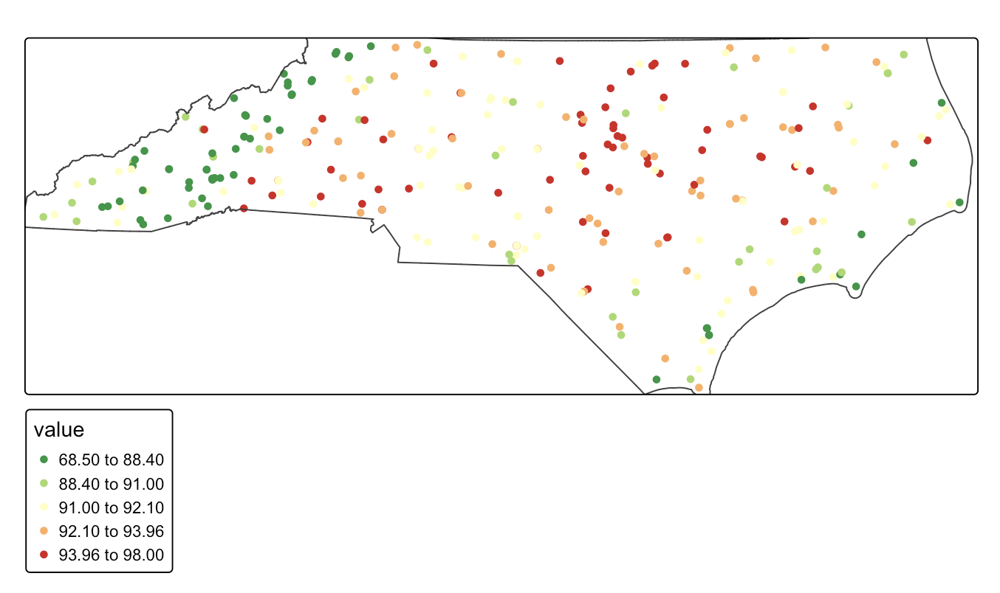
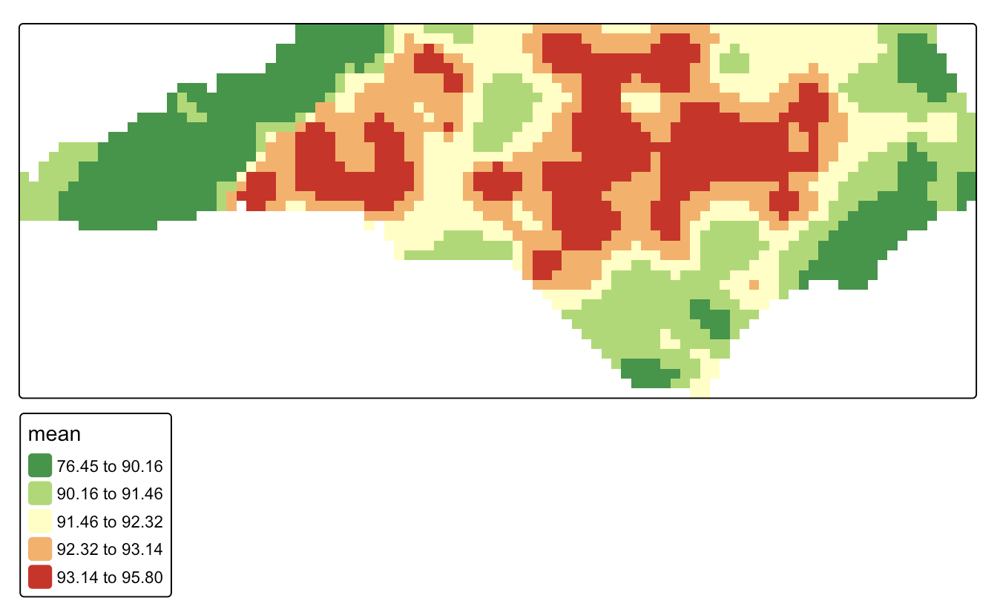
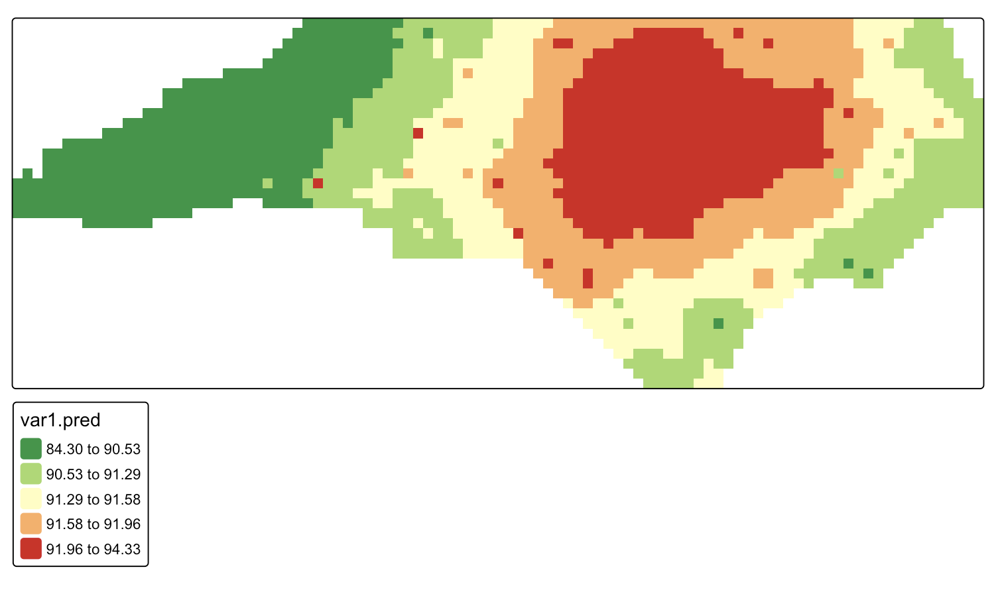
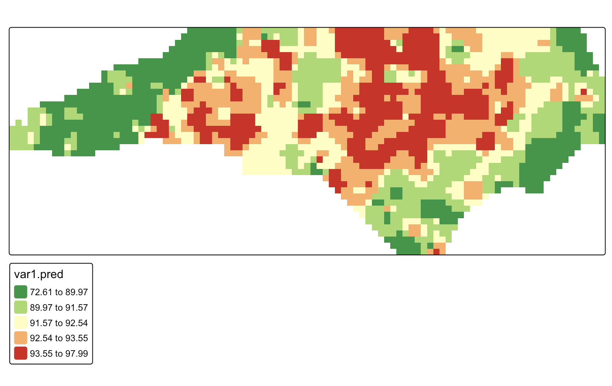
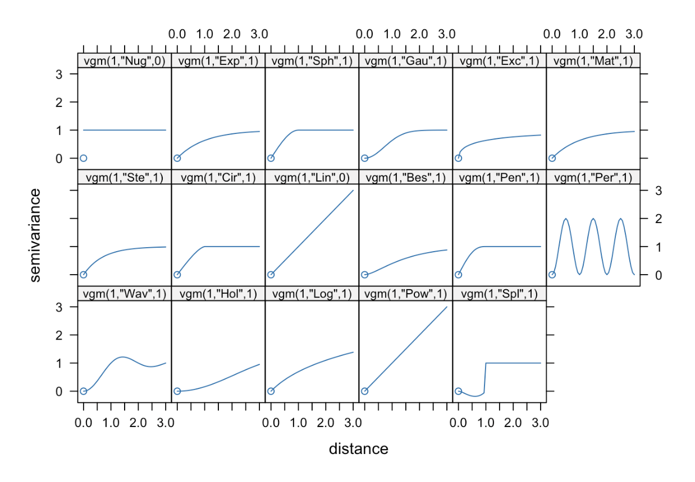

Some phenomena are spatially continuous, meaning they are present at every location rather than confined to discrete points. In many cases, however, data about these continuous variables are only collected at discrete locations (i.e. weather monitoring stations, stream gauges, sample sites). This is called geostatistical data, and it is the final type of data we will work with.

There are many circumstances in which we might want to predict these continuous values at unsampled locations. For instance, imagine you had temperature data at weather stations during a July 2025 heatwave. Weather stations aren't everywhere, but we might need a continuous surface to answer questions like:

-   What was the estimated temperature at a specific location (e.g. a hospital), where there was no monitoring station?

-   What areas of the state likely exceeded a threshold of 92 degrees?

{fig-alt="Map of temperature values at weather stations across North Carolina in July 2025. Especially hot values across Piedmont"} {fig-alt="Example model of continous surface estimated from point estimates"}

Spatial interpolation is how we can estimate these unsampled values and is the main method used with geostatistical data. Spatial interpolation is built around the fundamental assumption of spatial autocorrelation---that nearby features are more similar than features that are further apart. That means that we can leverage the points nearby an unsampled location to come up with an estimate of the value at that location.

This reading will introduce you to two common approaches to spatial interpolation: Inverse Distance Weighting and Kriging.

### Deterministic Method: Inverse Distance Weighting (IDW)

Inverse Distance Weighting is a deterministic method that predicts unsampled locations as a weighted average of nearby observations. Because it is deterministic, that means that IDW does not model uncertainty or randomness---the predicted values are determined entirely by the known sample points and the weighting scheme. There are two important parameters in an IDW. The first is the size of the prediction pixel. Since we are moving from point data to raster data, we must define the size of the pixel. This should be based on the scale of the phenomenon being modeled and the density of the input data. A fine resolution is more appropriate when data points are dense and there is a lot of spatial variation, whereas coarse resolution is often more appropriate when data are sparse or the phenomenon changes more gradually.

The second important parameter is the Inverse Distance Power (IDP). The IDP (or $p$) controls how rapidly influence declines as distance increases and is usually between 1-3. With a $p\  = \ 1$, influence declines slowly with distance and distant points still contribute meaningfully to the estimate, resulting in a smooth, generalized surface. With a $p\  = \ 2$, influence declines more noticeably with distance, giving nearby points stronger control but balancing this with broader context. With a $p\  = \ 3$ , influence declines rapidly, which results in a more locally sensitive surface. Selecting the IDP should be broadly based on the estimated spatial process. Do we expect that spatial autocorrelation is very local, or highly global? Conceptual selection of IDP can also be supplemented by testing different IDP values for the lowest RMSE.

The formula for IDW is as followed:

$$\widehat{Z}\left( x_{0} \right) = \frac{\sum_{i = 1}^{n}\frac{Z\left( x_{i} \right)}{d\left( x_{0},x_{i} \right)^{p}}}{\sum_{i = 1}^{n}\frac{1}{d\left( x_{0},x_{i} \right)^{p}}}$$

Where:

-   $\widehat{Z}\left( x_{0} \right)\ $ is the predicted value at location $x_{0}$

-   $Z\left( x_{i} \right)$ is the observed value at location $x_{i}$

-   $d\left( x_{0},x_{i} \right)$ is the distance between prediction location and known point

-   $p$ is IDP

-   $n$ is the number of neighboring points used in the estimation.

{fig-alt=""}{fig-alt=""}

P = 1 P= 4

### Moving from Deterministic to Probabilistic

As we have already learned, most geographic processes are complex and only partially observed, which means that they are best modeled as stochastic processes. More advanced interpolation methods take this approach by modeling the unknown spatial surface as a realization of a probabilistic process. The key advantage of probabilistic approaches is that they try to model the data generation process. IDW does not include an explicit model of the underlying spatial process and does not estimate uncertainty. Probabilistic methods such as kriging assume that the data arise from a spatial process, explicitly model how similarity changes with distance (through a variogram), and use that model to derive optimal weights. This allows them to produce both predictions and associated measures of uncertainty.

### Gaussian Random Fields

A common assumption in probabilistic approaches to interpolation is that the spatial process follows a Gaussian Random Field (GRF). The key idea in a GRF is that there is a true, continuous surfaces that exists everywhere but that we do not observe it directly. Instead, we observe one realization of a random process at certain discrete locations along the continuous surface. In a GRF, each location is associated with a normally distributed random variable, and any set of locations is assumed to follow a joint normal distribution. The strength of the correlation between sets of locations depends on the distance, which is described using a semivariogram.

A GRF framework combines three components: an assumption about the distribution of values (Gaussian), a model of how similarity changes with distance (spatial correlation), and an acknowledgment that the data are imperfect observations of an underlying process. This allows methods like kriging to produce statistically optimal predictions along with uncertainty estimates.s

### Kriging

Similar to IDW, Kriging calculates a weighted average of nearby points to estimate values at an unsampled location. However, unlike IDW, which determines prediction weights solely based on distance, kriging uses a semivariogram model to describe spatial autocorrelation by characterizing how spatial similarity declines as the distance between locations increases.

To execute a kriging interpolation, we start by calculating an empirical semivariogram for our data. The empirical variogram summarizes how differences between observed values change with distance by computing the average semivariance between pairs of observations at different separation distances. To interpret a semivariogram, we look at how the semivariance changes as the distance between observations increases. At short distances, the semivariance is low, which indicates that nearby points tend to have similar values and are strongly spatially correlated. As the distance increases, the semivariance also increases, showing that observations become less similar. Eventually, the semivariogram levels off, indicating that beyond a certain distance there is little to no spatial correlation between points.

The value where the curve begins is called the nugget and represents measurement error or very small-scale variation. The plateau that the curve reaches is called the sill and reflects the overall variance in the data. The distance at which the curve flattens is called the range and marks the point beyond which observations are effectively independent.

We then match the overall shape of the empirical variogram to a theoretical variogram model, which provides a smooth mathematical function describing the spatial dependence structure of the data. The most commonly used models include the spherical, exponential, and Gaussian variogram models.

{fig-alt=""}

Once a theoretical variogram model is fitted, it provides a mathematical description of how spatial dependence changes with distance. The kriging model uses this function to quantify how strongly each observed point is related not only to the prediction location, but also to every other observed point. This model can then be used to calculate the weights to use for the weighted average.

The kriging prediction is computed as a weighted sum:

$$\widehat{Z}\left( x_{0} \right) = \sum_{i = 1}^{n}{\lambda_{i}Z\left( x_{i} \right)}$$

Where:

-   $\widehat{Z}\left( x_{0} \right)$ is the predicted value at an unsampled location

-   $Z(x_{i})$ is the observed values

-   and $\lambda_{i}\ $are the weights determined from the variogram.

Kriging also provides an estimate of uncertainty, called the kriging variance, which is derived from the same variogram model used to calculate the weights. It reflects how well nearby observations can predict the value at a location based on their distance, spatial arrangement, and degree of correlation. Areas with dense, strongly correlated nearby points have lower uncertainty, while areas with sparse or distant observations have higher uncertainty.

### Covariates

In the two approaches explored in this reading, estimates at unsampled locations are based entirely on spatial autocorrelation (i.e. we can guess these values based on the values that are nearby since we know that they are related). However, we often have additional information, such as environmental variables or underlying gradients, that can improve our predictions. For example, factors like elevation, temperature, land cover, or soil type may influence the values we are trying to predict. These factors can be included as covariates in more advanced kriging methods. By including covariates, we can move beyond relying only on spatial proximity and instead model both spatial structure and explanatory relationships. Methods such as regression kriging or universal kriging combine a regression component (which captures the relationship between the response and covariates) with a kriging component (which models the spatial correlation in the residuals). This allows us to first explain large-scale trends using covariates and then account for remaining spatial dependence, resulting in more accurate and informative predictions than using spatial autocorrelation alone.

## Reading quiz {.unnumbered}

::: {.reading-quiz data-quiz="continuous-surfaces"}
The quiz needs JavaScript. If it does not load, refresh the page.
:::
