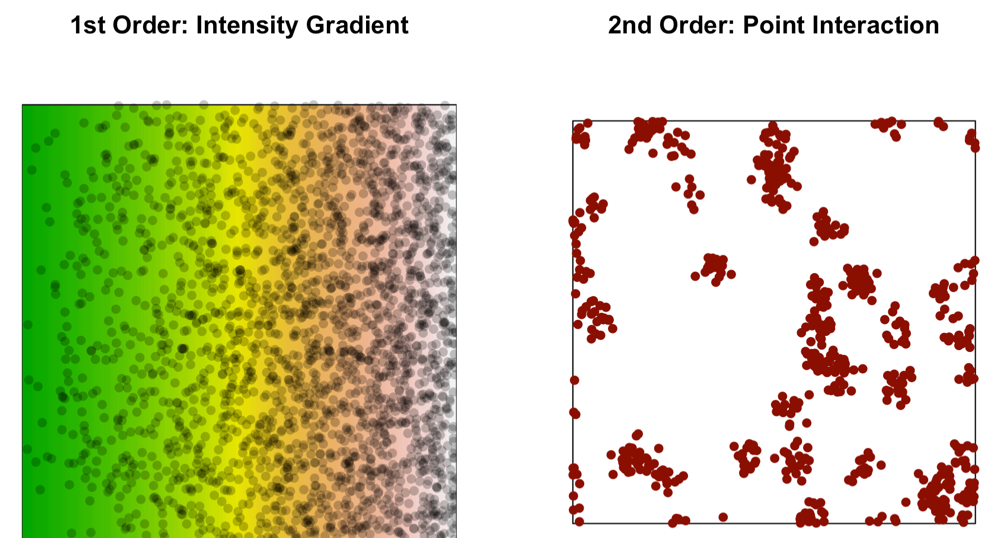
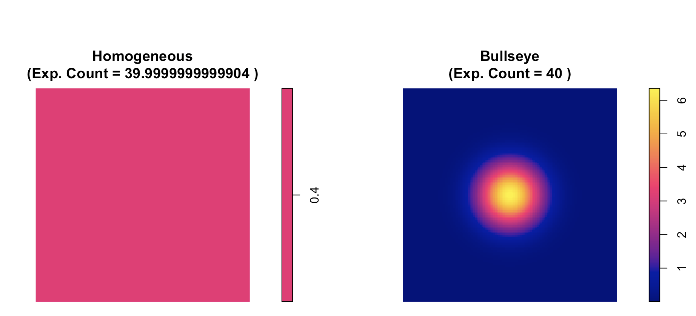
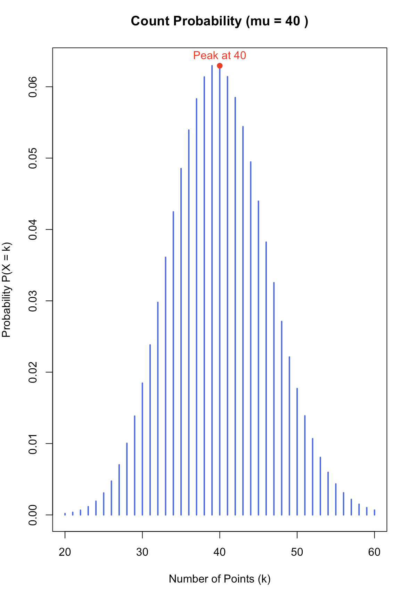
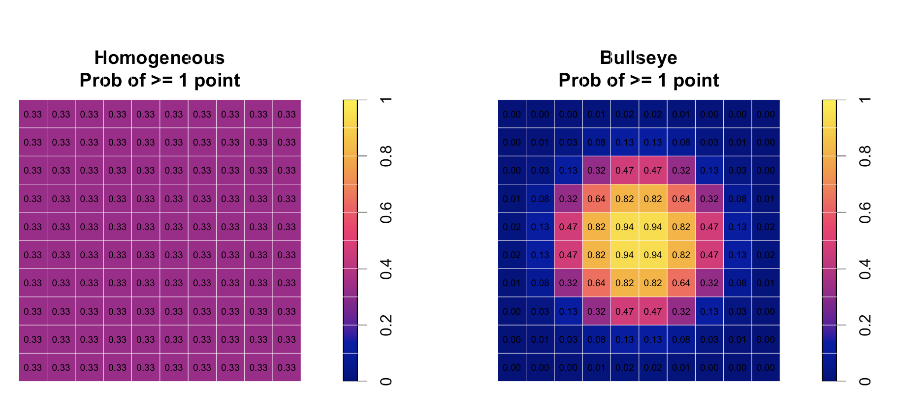
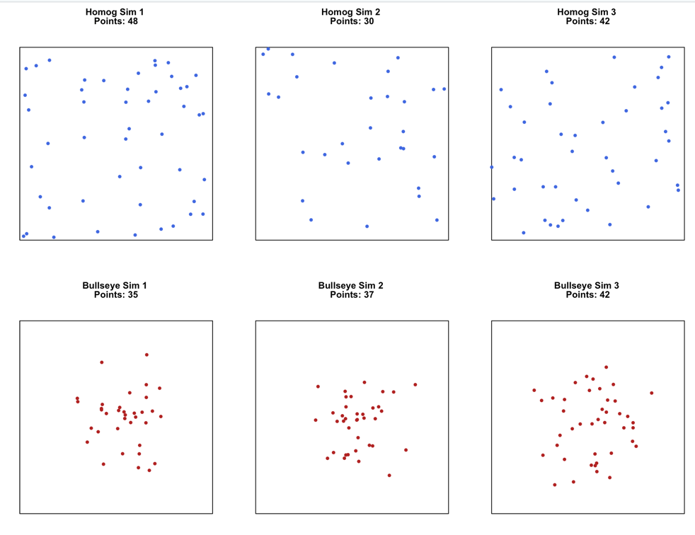
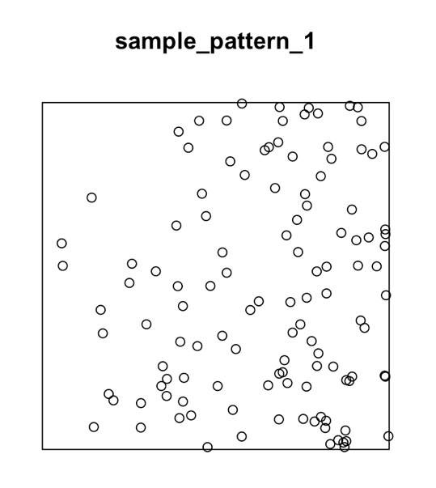
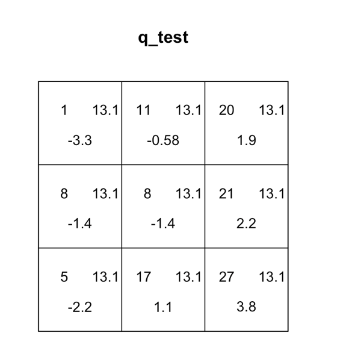
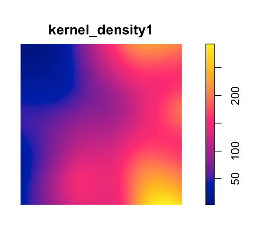

### Overview

A spatial point pattern consists of the locations of discrete events occurring within a defined study region. Events are treated as realizations of an underlying spatial process. Examples include species locations, lightning strikes, crime incidents, and cases of diseases. Point pattern analysis asks whether the observed arrangement of events is consistent with randomness or whether it exhibits structure like clustering or regularity.

The three possible spatial patterns are:

-   **Complete Spatial Randomness (CSR):** In this pattern, events occur independently and are equally likely anywhere within the study region. There is no attraction or repulsion, intensity is constant, and variation arises solely from chance.

-   **Clustered**: Events occur closer together than expected under CSR. This clustering can occur because of a first-order process which causes intensity variation (i.e. higher intensity in one part of the study region) or a second-order process (due to attraction)

{fig-alt="A comparison of different colors of a gradient"}

-   **Regular**: Events are more evenly spaced than expected under CSR. Regularity primarily arises from second-order processes (repulsion or competition)

Across all types of spatial data, spatial patterns/structure can exist at two levels---first-order structure and second-order structure. First-order structure describes the spatial pattern resulting from the varying intensity of a process across space. It reflects the "global" external drivers (such as the environment, social policy, or infrastructure) that makes some areas inherently different from the others. Second-order structure describes the spatial pattern resulting from interaction between observations themselves.

### The Poisson Distribution and Complete Spatial Randomness (CSR)

For analyzing point pattern structure, CSR serves as the baseline null model, representing the absence of spatial interaction or variance in intensity. Random does not mean evenly spaced; apparent clusters or gaps can still arise by chance. CSR is represented mathematically by the homogeneous Poisson point process. CSR is defined by two assumptions:

-   Uniformity (homogeneity): Events are equally likely to occur anywhere within the study region. The expected event density, or intensity λ, is constant across space.

-   Independence: The location of each event is unaffected by the locations of all other events. Events do not attract or repel each other.

The Poisson distribution is considered the standard for modeling spatial patterns because it is specifically designed for discrete counts of "rare" events distributed over a continuous space. In the context of a spatial point process, the probability of an event occurring at any single location is extremely small (given that there is an infinite set of coordinate locations $(x,\ y)$ within the study area) which aligns with the definition of a rate event.

As noted, a point pattern is homogeneous when intensity is constant across the study region: λ(A)=λ. Real geographic systems often violate this assumption because environmental conditions vary in space. When intensity varies with location, the pattern is inhomogeneous, and the inhomogeneous Poisson process is used. Even with spatially varying intensity, independence between event locations is maintained in an inhomogeneous Poisson process: events respond to the environment but not directly to one another.

It is important to distinguish between intensity and density, as they are related but conceptually distinct. Density is the observed number of points per unit area. Intensity is the underlying rate or likelihood that a point occurs at a location. Intensity is a property of the process generating the pattern. However, we often estimate intensity using observed data (density).

If you are using density as an empirical estimate of intensity, you can calculate it as number of points over area:

$$\widehat{\lambda} = \frac{n}{a}$$

In the formulas below, a homogenous Poisson process can be modeled by setting intensity to a constant.

**Expected Number of Events**

> $$\mu(A) = \ \int_{A}^{}{\lambda(x)}dx$$

$\mu(A)$: the expected (average) number of events in the region $A$

$A$: the region we are looking at (area, volume, etc.)

$\lambda(x)$: intensity at location $x$, i.e., the rate of occurrence per unit space

$\int_{A}^{}{\ldots dx}$: sum up the intensity over all points in $A$

This formula calculates the expected total count of points in a region by integrating the intensity over all locations in A

For instance, take the example intensity surfaces below. For both, the expected number of events is 40, but one estimates a homogenous process and one an inhomogeneous process. However, the integral of the intensity is the same over the study area. The window is defined on (0,10) X (0,10), so the intensity values represent expected counts per unit square (i.e. the value corresponds to what would be expected within a 1x1 grid cell). The expected count is defined by summing up the intensity across the entire study region.

{fig-alt="A comparison of a number of colored squares"}

**Probability Distribution of the Number of Events**

$$P\left( N(A) = n \right) = e^{- \mu(A)}\frac{\mu(A)^{n}}{n!}$$

$P(N(A) = n)$: the probability that exactly $n$ events occur in region $A$

$\mu(A)$: the expected number of events from Formula 1

$n!$: factorial of $n$(1×2×...×n) to account for all the different ways those n events could be arranged

This formula uses the expected number of events $\mu(A$) to calculate the exact odds of finding a specific number of points.

Because the expected total number of events is the same for both intensity fields, the total count over the study window follows the same Poisson distribution in each case.

{fig-alt="A graph of a graph"}

**Location of Events**

$$f(x) = \frac{\lambda(x)}{\mu(A)}$$

$f(x)$: the probability density of an event occurring at location $x$. It represents the relative likelihood of a single event occurring at that precise coordinate

$\lambda(x)$: The raw \"local intensity\" or rate of occurrence per unit space at that point

$\mu(A)$: The total intensity over the entire study region, as calculated in Formula 1. This value is used here to normalize the probability.

Important clarification: f(x) is a density, not a probability. The probability of an event occurring at a single, exact point is 0. To obtain an actual probability, you must integrate the density over a region with non-zero area. For instance, for our (0, 10) X (0,10) window, we can assign a probability that at least 1 event occurs in each 1X1 grid:

{fig-alt="A comparison of colored squares"}

We can then simulate realizations of our process!

{fig-alt="A screenshot of a computer game"}

### A Minimal Workflow for Diagnosing Structure in Point Pattern Data

This course emphasizes diagnosing spatial structure rather than formally modeling point processes because model-based inference requires strong assumptions about the underlying data-generating mechanism. Since these mechanisms are typically unknown at the outset, exploratory diagnostic methods are used first to determine whether departures from complete spatial randomness exist and to characterize their spatial scale

Most point pattern analytical tests (which the exception of quadrat density tests) do not have a formal hypothesis testing framework because many spatial point-pattern statistics do not have tractable variance formulas under CSR, which prevents classical hypothesis testing. As a result, inference in point-pattern analysis is commonly performed using simulation-based methods. In this course, Monte Carlo simulation is used to generate realizations of homogeneous and inhomogeneous Poisson point patterns under CSR, allowing comparison between observed statistics and those expected under spatial randomness.

#### Diagnosing First-Order Spatial Structure

**Step 1: Global Randomness Test**

The quadrat density test allows us to test for CSR at a global level. Quadrat density testing involves dividing the study area into sub-regions (quadrats). For each quadrat, the local density is computed by dividing the number of points by the area of the quadrat. A quadrat test uses a Chi-squared test of CSR using quadrat counts to compare the expected distribution of events on quadrats under the null landscape to the observed distribution. The quadrat test calculates a residual based on the difference between the observed and expected number of events. The independence test is calculated from the residuals (squared sum of the Pearson residuals). The smaller this number is, the more likely that the observed pattern of events is not different from the null landscape (can be interpreted by the p-value). The quadrat test is highly sensitive to the number and size of quadrats, as well as the defined region of analysis.

{fig-alt="A black and white image of a square with dots"}{fig-alt="A grid of numbers with a white background"}

Although the quadrat density test does have a formal hypothesis-testing framework based on the chi-squared distribution, we often also use Monte Carlo simulation to evaluate departures from CSR. The analytical chi-squared test relies on assumptions such as independent Poisson counts and sufficiently large expected frequencies, which are often only approximately satisfied in spatial datasets. In addition, quadrat tests are sensitive to quadrat size, placement, and study-area geometry. Monte Carlo simulation generates realizations of CSR within the observed study window and produces an empirical null distribution for the test statistic, providing a more robust and consistent basis for inference.

**Step 2: Kernel Density Estimation**

KDE is a method for estimating the spatial intensity of a point pattern by using a moving window controlled by a kernel, which is a mathematical function that defines how much influence each point has on the estimated intensity at a location. A kernel is typically defined by selecting a function that declines with increasing distance (i.e. greater weight is given to events that are close to the center of the window). A simple kernel is defined by the normal distribution (Gaussian kernel) where highest influence is at 0 distance. The shape of the Gaussian Kernel depends on the standard deviation, which controls how large the window is, which we call the kernel bandwidth. KDE is often used as an exploratory step to identify trends or hotspots that might suggest covariates that are leading to spatial order at the first-level.

{fig-alt="A colorful gradients and numbers"}

There is no formal hypothesis testing in KDE. Instead, KDE is often used as an exploratory step to identify trends or hotspots that might suggest covariates that are leading to spatial order at the first-level. Additionally, KDE outputs are often incorporated as inputs in subsequent analyses, such as inhomogeneous point process models, to examine second-order spatial effects while accounting for spatially varying intensity.

#### Diagnosing Second-Order Spatial Structure

**Average Nearest Neighbor (ANN)**

The ANN statistic is a distance-based method for summarizing local spatial structure in a point pattern. ANN is focused specifically on the distance of each point to its nearest neighbor. Therefore, ANN is useful for identifying very local clustering.

The expected nearest neighbor distance under Complete Spatial Randomness (CSR) is defined analytically as:

$$ANN_{expected} = \frac{1}{2}\sqrt{\frac{A}{n}}
$$

The ANN ratio is then computed as:

$$R = \frac{ANN_{observed}}{ANN_{expected}}
$$

R\< 1 indicates clustering

R around 1 indicates randomness

R \>1 indicates dispersion

Monte Carlo simulation can be used to empirically calculate p-values. We can simulate many realizations of our null hypothesis (CSR) and compare our observed data to the data generated by our simulated process. If the point pattern exhibits first-order inhomogeneity, we can still simulate patterns under an inhomogeneous null model by using a KDE to approximate intensity across the study region and use that intensity to generate simulated patterns.

The empirical p-value can be calculated as:

$$p = 2 \times \min\left( \frac{N_{\text{greater}} + 1}{N + 1},\frac{N + 1 - N_{\text{greater}}}{N + 1} \right)$$

**Where** $N_{greater}$ is how many of the simulated values are more extreme (higher or lower) than our observed statistic.

**K-Function**

Ripley's K-function summarizes the spatial clustering or inhibition of points across different distances. It compares the observed distribution of interpoint distances to what is expected under complete spatial randomness, with values above the theoretical line indicating clustering and values below indicating regularity. The Homogeneous k-function is defined as:

> $$\widehat{K}(d) = \frac{A}{n(n - 1)}\sum_{i = 1}^{n}{\sum_{j \neq i}^{n}{I\left( d_{ij} \leq d \right)}}$$
>
> Where:
>
> $i$= reference point
>
> $j$= other points in the dataset (excluding $i$)
>
> $d$= distance at which neighbors are counted
>
> $d_{ij}$= distance between points $i$and $j$
>
> $I(d_{ij} \leq d)$= indicator function; 1 if $d_{ij} \leq d$, 0 otherwise
>
> $\sum_{i = 1}^{n}\sum_{j \neq i}^{n}$sum over all distinct pairs of points
>
> $n(n - 1)$= total number of ordered pairs; normalizes the count
>
> $A$= area of the study region; scales the fraction to area units

This can be interpreted as: for each point, count how many other points lie within distance d, then some these counts across all points. Normalize by the total number of pairs and multiply by the study area so the result can be compared to what is expected under complete spatial randomness.

There is an inhomogeneous version of the K-function which can be used when there is first-order structure. The inhomogeneous K-function modifies the pair counts by weighting each point pair by the reciprocal of their estimated densities (which can be estimated by a KDE), which accounts for spatial variation in the point density and allows the detection of clustering or inhibition that is not due to first-order intensity trends.

The K-function is highly sensitive to edge effects because points near the boundary of the study region have portions of their surrounding neighborhoods lying outside the observation window, causing neighbors to be missed and leading to systematic underestimation of interpoint counts at larger distances. Edge‐correction methods are therefore commonly applied to compensate for the truncated search area and reduce bias in the estimated K-function.

We can use Monte Carlo simulation to generate envelopes that demonstrate different realizations of CSR to formalize inferential testing. By simulating many realizations of the null model, we can empirically estimate the range of expected values at each distance and determine whether the observed pattern deviates significantly from randomness. However, we will only use simulation envelopes for testing homogeneous point pattern analysis because the inhomogeneous K-function depends on an estimated intensity surface, typically obtained using a kernel density estimate (KDE). While the inhomogeneous K-function can adjust for first-order intensity variation descriptively, uncertainty in the KDE propagates into simulations, making the null model partly determined by estimation choices rather than a clearly specified stochastic process.

## Reading quiz {.unnumbered}

::: {.reading-quiz data-quiz="point-pattern-analysis"}
The quiz needs JavaScript. If it does not load, refresh the page.
:::
