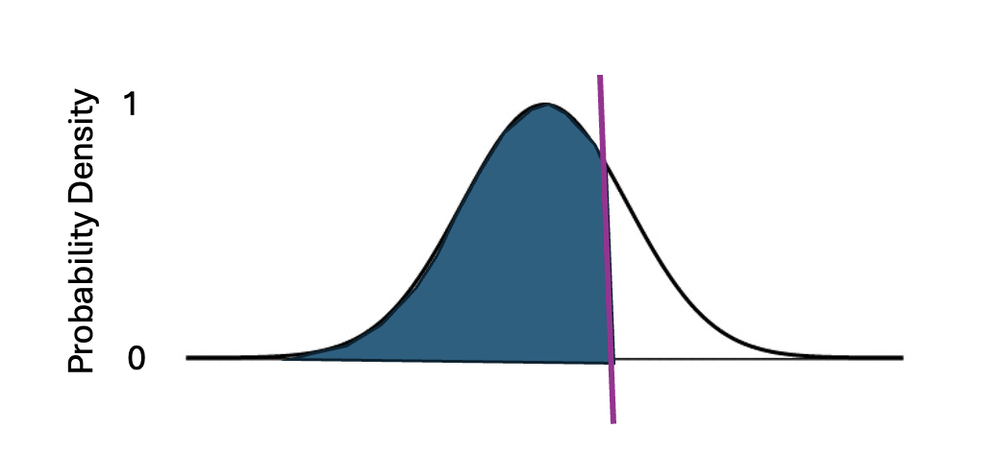
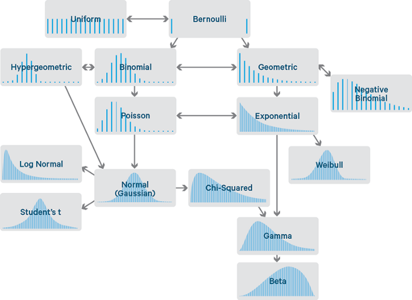

## Probability in Quantitative Methods in Geography

### Overview

All the remaining methods that we are going to use in this course use aspects of probability. At the most basic level, probability is the study of uncertainty and the likelihood that particular events or outcomes will occur. If geographical processes were perfectly predictable, we would have no need for probability. However, pretty much all geographic data and geographic processes have some element of uncertainty.

In geography, uncertainty emerges from several sources:

-   **Stochasticity (randomness):** Many environmental and social geographical processes are stochastic because they are shaped by numerous interacting factors, some of which are unobservable or inherently random, although the underlying processes are partly understood and can therefore be modelled probabilistically

-   **Measurement error:** Data collection methods are imperfect, and this introduces uncertainty

-   **Sampling uncertainty:** Geographers often work with samples rather than complete populations which introduces uncertainty

Probability gives us a formal way to quantify uncertainty rather than just acknowledging that it exists, which allows us to make more informed interpretations of geographical data.

### Probability Distributions

The foundation of probability analysis is the probability distribution. A probability distribution describes the likelihood of all possible outcomes for a random variable. A random variable is any variable whose outcome involves uncertainty, regardless of the source of that uncertainty.

Probability distributions can be either empirical or theoretical and either discrete or continuous.

Empirical probability distributions are constructed directly from observed data. For example, if we have 50 years of recorded summer temperatures in a city, we can estimate the probability distribution of different temperatures based on historical observations. Theoretical probability distributions are mathematically defined models that describe how values are expected to be distributed based on certain assumptions about the underlying process. Unlike empirical distributions, they are not derived directly from observed frequencies, but from probability theory. These distributions are useful because they allow probabilities to be calculated analytically and generalized beyond the observed data.

Discrete distributions describe variables that take on distinct countable values, for example: the number of traffic accidents at an intersection, the number of floods occurring in a decade, the number of households with internet access. For discrete variables, probabilities can be assigned to exact values. Continuous distributions describe variables measured along a continuum, such as temperature, elevation, distance, amount of rainfall. In continuous distributions, the probability of observing one exact value is effectively 0. Instead, probabilities are calculated over ranges of values.

To understand how probability distributions work, consider the normal distribution shown below. The normal distribution is one of the most widely used theoretical probability distributions. It is characterized by a bell-shaped curve that is symmetric around its mean, with most observations concentrated near the center and fewer observations appearing farther from the mean. When working with a probability distribution, we are often interested in the probability that an observation falls below or above a specific value. In a normal distribution, this probability is represented by the area under the curve to the left or right of that value. By calculating or summing this area, we obtain the probability that a randomly selected observation is less than the specified value.

{fig-alt=""}

Probability distributions can take many different shapes because different real-world phenomena produce different patterns of outcomes. Some variables tend to cluster symmetrically around an average value, while others are skewed toward larger or smaller values or contain greater variability. Despite these differences in shape, all probability distributions share the same underlying purpose: describing how probabilities are distributed across the possible values of a random variable.

{fig-alt=""}

Selecting an appropriate probability distribution depends on the characteristics of the data, whether the variable is discrete or continuous, the underlying process being modeled, and the assumptions required by statistical methods. In many of the statistical tests that we are going to use in this class, the choice of probability distribution is already built into the method itself.

### Using Probability

Probability shows up in different ways in our methods; the section below is intended to provide a very brief conceptual overview of how probability is used in different ways. We'll go more into detail on all of these!

#### Simple Event Probabilities

In simple event probabilities, we are interested in the chance of an event occurring. For instance, the chance that it rains tomorrow, or the chance that the temperature exceeds 92°F on July 15. Simple event probabilities are the most direct use of probability distributions, where the distribution itself is used to calculate the likelihood of outcomes.

The uncertainty in simple event probabilities comes from the fact that future outcomes cannot be predicted perfectly since environmental and social systems contain randomness (stochasticity)

There are two common approaches to calculating simple event probabilities: the empirical approach and the theoretical approach. In the empirical approach, probabilities are estimated directly from historical observations.

For example:

$$P(Temperature > 92^{\circ}) = \frac{Number\ of\ days\ above\ 92^{\circ}}{Total\ number\ of\ observed\ days}
$$

In this case, the uncertainty is represented directly by the observed variability in the historical data.

However, empirical distributions often approximate theoretical probability distributions. If this is true, researchers can fit a theoretical distribution to the data and calculate probabilities mathematically. For example, temperatures are often approximately Normally distributed, meaning probabilities can be calculated using the Normal distribution.

Theoretical distributions are useful because they allow researchers to estimate probabilities for values that may not have been directly observed in the sample and provide a mathematically consistent model of uncertainty. However, these distributions still require parameters (mean and standard deviation) which are usually estimated from empirical data.

#### Estimation in Sampling

Many geographical datasets are samples rather than complete populations. In this case, the uncertainty in estimation comes specifically from random sampling variability: different random samples would produce somewhat different estimates. Probability allows researchers to estimate population characteristics while accounting for this sampling variability.

For example, let's say we want to estimate the proportion of households with solar panels in a community. Instead of surveying every household we would probably collect a random sample. The sample proportion provides an estimate of the population value, but because the estimate depends on a sample, it is uncertain. Confidence intervals are used to quantify this uncertainty.

Estimation in sampling commonly uses the z-distribution and t-distribution, both of which are bell-shaped probability distributions used to describe the behavior of sample estimates under repeated sampling.

#### Non-Spatial Hypothesis Testing

Building on estimation in sampling, non-spatial hypothesis testing uses probability distributions to evaluate whether observed differences or relationships in data are likely to reflect genuine patterns or could plausibly have occurred by random chance (the null hypothesis). The uncertainty in hypothesis testing comes primarily from sampling variability. Even if there were no true difference between groups in the population, random sampling could still produce differences in sample means or proportions.

For example, a one-sample t-test might be used to determine whether the average rainfall in a region differs from a known historical average. A two-sample t-test could compare average household incomes between two cities, while a paired t-test might evaluate whether air pollution levels changed before and after a policy intervention in the same location. Chi-square tests, in contrast, are commonly used with categorical data and frequency counts, such as examining whether transportation mode differs across neighborhood types or whether voting preferences vary by age group.

These methods compare observed sample statistics to probability distributions expected under a null hypothesis. Depending on the structure of the test, they typically rely on the t-distribution, chi-square distribution, F-distribution, or normal distribution to determine how likely the observed results would be if the null hypothesis were true.

#### Spatial Pattern Analysis

Spatial pattern analysis asks whether observed spatial arrangements could reasonably have emerged by chance or whether they suggest the influence of an underlying spatial process. The uncertainty in spatial pattern analysis comes from stochastic spatial variation. Even completely random spatial processes can generate apparent clusters, gaps, or trends simply by chance.

Spatial statistical methods compare observed spatial patterns to probability distributions representing random spatial arrangements. These reference distributions are often generated analytically or through randomization methods such as Monte Carlo simulation.

#### Spatial Modeling

Spatial modeling extends probability-based reasoning to explain or predict geographical processes. Models such as ordinary least squares (OLS) regression estimate relationships between variables while accounting for uncertainty in the observed data.

The uncertainty in spatial modeling comes from several sources:

-   sampling variability

-   measurement error

-   omitted variables

-   stochastic variation in the underlying process

Probability distributions are used to model the uncertainty in regression coefficients, residual errors, predictions, and hypothesis tests.

OLS regression typically assumes that residual errors follow a Normal distribution with constant variance. This assumption allows researchers to calculate confidence intervals, p-values, and prediction intervals. Spatial models extend these ideas by recognizing that observations located near one another are often not independent. Spatial regression models incorporate probability structures that explicitly account for spatial autocorrelation in the residuals or dependent variable.

This allows researchers to separate meaningful spatial processes from random spatial variability and produce more reliable statistical inference.

### A Note on Natural Samples in Geography

An important distinction in statistics is the difference between a sample and a population. In classical statistical inference, probabilistic methods are primarily used when working with samples because the goal is to make inferences about a larger population that has not been fully observed. If the entire population is known, there is theoretically no sampling uncertainty and no need to estimate population parameters from a subset of observations.

Geography, however, often operates differently from this idealized framework in two important ways. First, geographic data are frequently observational rather than the result of carefully designed probability samples. Researchers often work with administrative units, census data, historical records, remote sensing products, or other naturally occurring spatial units. In these situations, the data were not generated through a formal random sampling process, meaning that some of the assumptions underlying classical statistical inference may not be fully satisfied.

Second, geographers are often interested in explaining the processes that generate observed spatial patterns rather than simply describing populations. Even when a dataset contains the entire population (for example, all neighborhoods in a city or all counties in a country), the observed arrangement is still understood as one possible realization of underlying spatial processes that contain randomness. This means that different spatial arrangements could emerge by chance rather than from a systematic geographic process. Probability therefore provides a way to evaluate whether an observed pattern is likely to reflect a systematic geographic process or could plausibly have arisen through random variation alone. In this case, probability is not only about uncertainty from sampling, but also about uncertainty arising from the processes generating the observed world itself.

Because of these two features, probabilistic reasoning remains central in geography even when researchers are not working with traditional random samples. Statistical inference is therefore often used to evaluate whether observed spatial relationships are likely to reflect broader systematic processes rather than random variation alone.

## Reading quiz {.unnumbered}

::: {.reading-quiz data-quiz="probability"}
The quiz needs JavaScript. If it does not load, refresh the page.
:::
