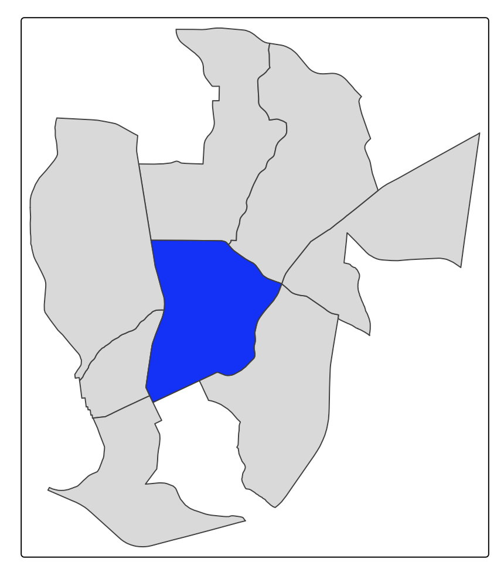
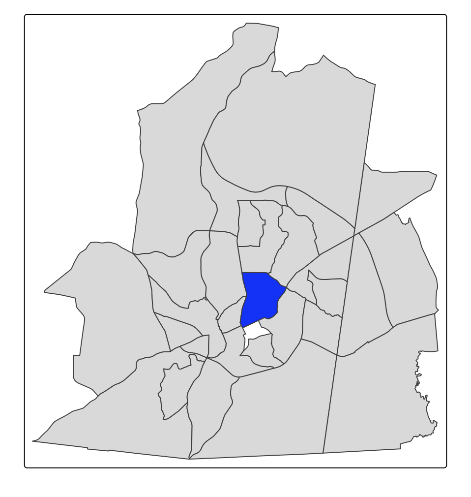
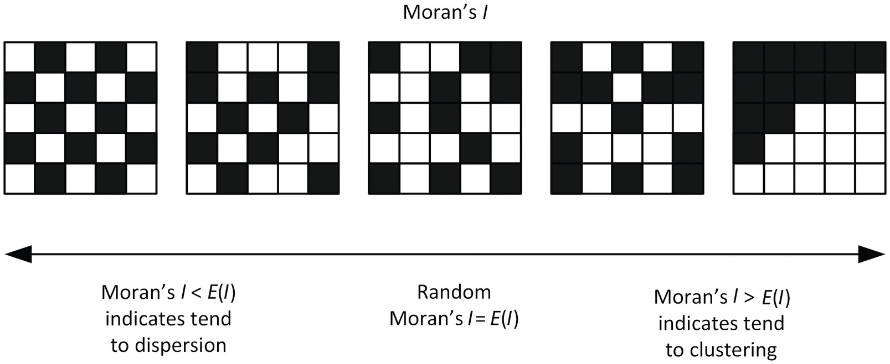
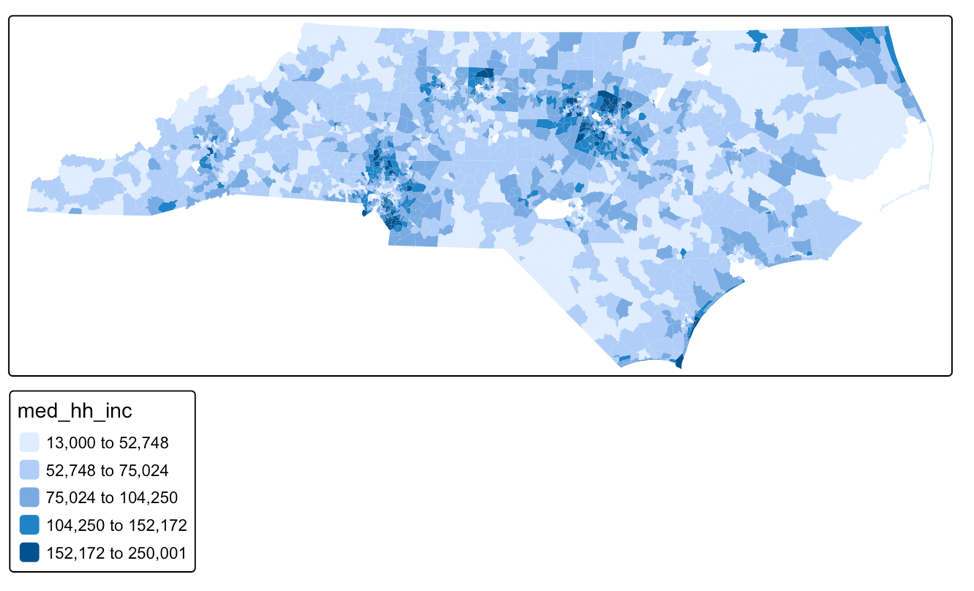
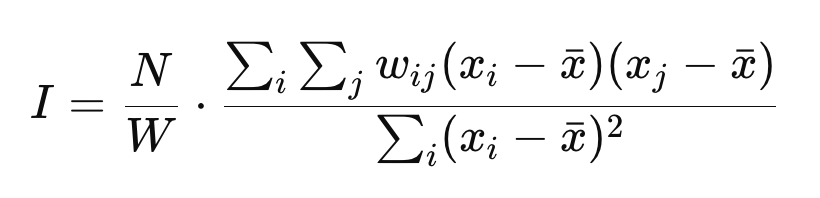
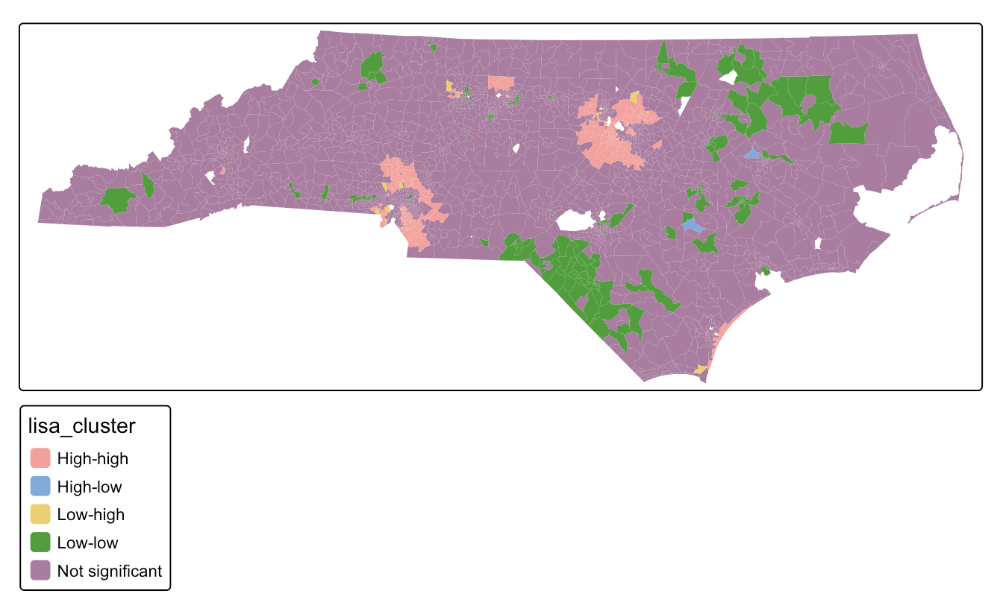

## Areal Data and Marked Point Patterns

The second type of data we will work with is areal data and marked point patterns. In areal data, observations are associated with predefined spatial units (such as regions or boundaries). Because these boundaries are arbitrarily defined, the exact locations within them are not inherently meaningful, and analyzing the spatial arrangement of locations themselves is not useful. Marked point patterns consist of observations at specific locations where each point has an associated value (or "mark"). Here, both the location and the value are meaningful, allowing for analysis of how values vary across space.

For both data types, a central concept is spatial autocorrelation, which measures the degree to which nearby features have similar or dissimilar values. Assessing spatial autocorrelation helps reveal the underlying spatial structure of the data and can inform or improve subsequent modeling approaches.

### Defining Neighborhoods

Spatial autocorrelation considers the relationship in values between features and their neighbors. Therefore, to be able to analyze spatial autocorrelation, we need a standard definition of a "neighborhood" for each feature in the dataset. Autocorrelation statistics then use these neighborhoods, which are encoded into a neighborhood weight matrix, to assess how similar or different neighbors are to their neighborhood. In this weight matrix, every feature in the dataset is associated with a different set of neighbors.

Deciding what neighborhood definition to use is more of an art than a science. The selected neighborhood definition should be based on a reasonable hypothesis about the mechanisms that may be producing autocorrelation, in combination with your study goals (i.e. are you interested in more local or more global clustering). You can check the sensitivity of your neighborhood definition by running spatial autocorrelation metrics for a set of different neighborhood definitions and compare the robustness of the results.

#### Topological Neighborhoods

Topological approaches use the topology of features to define neighborhoods. The two common topological approaches are the Queen's case and the Rook's case. Queen's case neighborhoods consider any feature that touches the feature of interest to be a neighbor. Rook's case considers any feature that shares more than a single point with the feature of interest to be a neighbor. Topological neighborhoods can be first-order (just those features immediately surrounding the feature of interest), or second order (which would include all first-order neighbors as well as all the first-order neighbors of those neighbors), depending how "global" you want your neighborhood definition to be. Small neighborhoods capture very local clustering, whereas large neighborhoods detect smoother, broader structure in the data.

Topological neighborhoods are often considered the standard for areal data. Because boundaries in areal data are often arbitrary and therefore there is an expectation of strong interaction across borders, topological approaches offer a reasonable estimation of interaction. Marked point data cannot be analyzed using topological neighborhoods given that points do not touch.

{fig-alt=""}

Queen's Case First-Order Neighborhood of Downtown Chapel Hill census tract

#### Distance-Based Neighborhoods

Distance-based approaches define neighborhoods based on how far different observations are from the feature. For instance, a 5-mile neighborhood would consider any feature within 5 miles of the feature of interest to be a neighbor. Changing the scale of the neighborhood changes how "global" or "local" your neighborhood definition is.

{fig-alt=""}

20-mile Neighborhood of Downtown Chapel Hill census tract

#### K-Nearest Neighborhoods

K-nearest neighbors assigns the same number of neighbors to each feature based on proximity. For instance, a 3-nearest neighborhood definition would select the three closest features to the feature of interest, regardless of the distance between them. K-nearest neighbors can be useful when a dataset has areas of sparse features, or when having a set number of neighbors is useful for the analytical goal.

### Measuring Autocorrelation

Once we have defined our neighborhoods, we can begin analyzing our dataset for spatial autocorrelation, which reflects the similarity, or dissimilarity, of features to their neighbors. There are many reasons why it can be useful to measure autocorrelation. Spatial autocorrelation allows us to characterize the spatial structure of a variable to be able to better describe the dataset or to facilitate generating hypotheses about spatial processes that may be causing the spatial pattern. Spatial autocorrelation can also serve as a diagnostic tool in spatial modeling to ensure that residuals are independently distributed.

#### Moran's I

We will use Moran's I to quantify global spatial structure. Moran's I provides a single value from -1 to 1 that describes how clustered, random, or dispersed the data is at the global level.

{fig-alt=""}

For instance, median household income by census tract across North Carolina has a Moran's I value of .59, indicating strong clustering.

{fig-alt=""}

Median Household Income across North Carolina

The formula for Moran's I is as follows:

{fig-alt=""}

Terms:

-   $n$: Number of observations or spatial units (e.g., regions, grid cells, cities).

-   $x_{i}$: Value of the variable of interest at location i.

-   $\bar{x}$: Average value of the variable across all locations.

-   $w_{ij}$ Spatial weight between location i and j, indicating how "connected" or "close" two locations are. Often 1 for neighbors, 0 otherwise.

-   $W$: Sum of all spatial weights, $W\  = \ \Sigma_{i\ }\Sigma_{j}W_{ij}$W

Description:

-   Numerator measures how much similar or dissimilar values occur at nearby locations. Positive if neighbors have similar deviations from the mean.

-   Denominator represents overall variance.

-   Moran's I is effectively a weighted correlation between a location's deviation from the mean and its neighbors' deviations.

Interpretation:

-   I \> 0: Positive spatial autocorrelation; similar values cluster together.

-   I \< 0: Negative spatial autocorrelation; high and low values are interspersed.

-   I \~ 0: No spatial pattern; values are randomly distributed.

Moran's I is conceptually similar to a correlation coefficient but applied to spatial data, accounting for neighborhood structure.

Like discussed in the Point Pattern chapter, structure in spatial data can emerge from chance alone. Therefore, we also need to test our Moran's I value for significance. To assess whether the observed Moran's I reflects a meaningful spatial pattern, it is compared to the theoretical Moran's I distribution under the null hypothesis of spatial randomness. We can also generate an empirical probability distribution for significance testing using Monte Carlo simulations.

#### Local Indicators of Spatial Autocorrelation (LISA)

LISA analysis measures spatial autocorrelation at the local level, identifying clusters or outliers in spatial data. Unlike Moran\'s I, which provides a single global measure of spatial autocorrelation, LISA calculates a statistic for each individual location, highlighting where significant spatial patterns occur.

$$I_{i} = \frac{\left( x_{i}-\overset{ˉ}{x} \right)}{m_{2}}\sum_{j}^{}w_{ij}(x_{j} - \overset{ˉ}{x})
$$where:\
$I_{i}$= local Moran's I for location $i$\
$x_{i}$= value at location $i$\
$\overset{ˉ}{x}$= mean of the variable\
$w_{ij}$= spatial weight between locations $i$and $j$\
$m_{2}$= variance term (often $\frac{1}{n}\sum_{i}^{}(x_{i} - \overset{ˉ}{x})^{2}$)\
$\sum_{j}^{}{}$= sum over neighboring locations $j$

The map below shows the significant LISA values for median household income across North Carolina

{fig-alt=""}

LISA analysis allows us to identify where statistically significant clustering or dispersion is occurring geographically in our dataset and can be interpreted as follows:

High--High (HH): Location has a high value, and neighbors also have high values; indicates a cluster of high values.

Low--Low (LL): Location has a low value, and neighbors also have low values; indicates a cluster of low values.

High--Low (HL): Location has a high value, but neighbors are low; indicates dispersion

Low--High (LH): Location has a low value, but neighbors are high; indicates dispersion

## Spatial Modeling

Before we get into spatial models specifically, it's helpful to step back and think about what models are doing more generally. At a basic level, a statistical model is trying to explain variation in a response variable using a set of predictors. We're asking: what factors help us understand why values differ across observations? A good model captures the systematic structure in the data (the part we can explain) and separates it from random noise. In other words, we're trying to explain as much of the meaningful pattern as possible and leave only unstructured randomness in the residuals.

When we move into spatial data, part of what we're trying to explain is how values vary across space. So instead of just asking why values differ, we're also asking why they differ where they do---why high values appear in some places and low values in others. Spatial patterns are often the result of underlying geographic, social, environmental, or economic processes. Spatial statistical methods help us detect and model these patterns, allowing us to develop and evaluate hypotheses about the processes that may have generated them. The challenge is that most standard models assume observations are independent, and don't account for spatial structure. That means spatial autocorrelation often ends up in the residuals, which violates model assumptions and can bias our results.

As we know, spatial data is inherently related to each other across space. Concerns that spatial dependence might be systematically biasing existing statistical models initially began to emerge in the 1970s. This led to the emergence of spatial econometric models, which extend traditional regression approaches by incorporating spatial relationships directly into the model. In this framework, spatial autocorrelation is typically treated as a statistical issue that must be accounted to obtain unbiased and consistent estimates.

The two most common spatial econometric models: the spatial lag model (SLM) and spatial error model (SEM), modify the classical regression framework in different ways. The spatial lag model incorporates the influence of neighboring outcomes directly into the dependent variable, while the spatial error model captures spatial dependence through the error term, representing unobserved spatial processes.

### Determining the Need for a Spatial Model

Regression analysis specifically requires that residuals are independent. Residual dependence can arise either because relevant spatial processes are not fully captured in the model (first-order structure) or because of spillover or diffusion processes across neighboring units (second-order structure). Both issues affect the accuracy of estimated coefficients: the first typically leads to inefficient estimates, while the second can bias the coefficients themselves. If there is residual autocorrelation, a spatial model is needed.

Even when there is no residual autocorrelation, that does not guarantee the coefficients are "correct" in a substantive sense because it can mean that spatial structure has been absorbed into the coefficients themselves. When that happens, the estimates may still be statistically valid, but they can be misleading in interpretation because they are partly capturing unmodeled spatial processes rather than only the intended relationships.

The selection of a Spatial Lag or Spatial Error model should be based primarily on hypotheses about how spatial processes operate in the data. In addition, model outputs can be compared, but this should be done in conjunction with theoretical expectations rather than relied on alone.

### Spatial Models

#### Spatial Lag Model (SLM)

The spatial lag model includes a spatially lagged version of the dependent variable, allowing outcomes in one location to be influenced by outcomes in neighboring locations. This approach is appropriate when the process itself is spatially contagious or when values diffuse across space (second-order structure).

$$y = \rho Wy + X\beta + \epsilon$$

where:\
$y$= dependent variable\
$X\beta$= covariates\
$W$= spatial weights matrix\
$\rho$= spatial lag coefficient\
$\epsilon$= independent error term

#### Spatial Error Model (SEM)

The spatial error model accounts for spatial dependence through the error term, capturing unobserved processes that are spatially correlated across locations. Rather than modeling direct spillover effects in the dependent variable, this approach is appropriate when spatial dependence arises from omitted variables or underlying factors that vary smoothly over space (first-order structure).

$$y = X\beta + u,\ \text{where}\text{ }u = \lambda Wu + \epsilon
$$

where:\
$u$= spatially autocorrelated error\
$\lambda$= spatial error coefficient\
$W$= spatial weights matrix\
$\epsilon$= independent error

## Reading quiz {.unnumbered}

::: {.reading-quiz data-quiz="spatial-modeling"}
The quiz needs JavaScript. If it does not load, refresh the page.
:::
